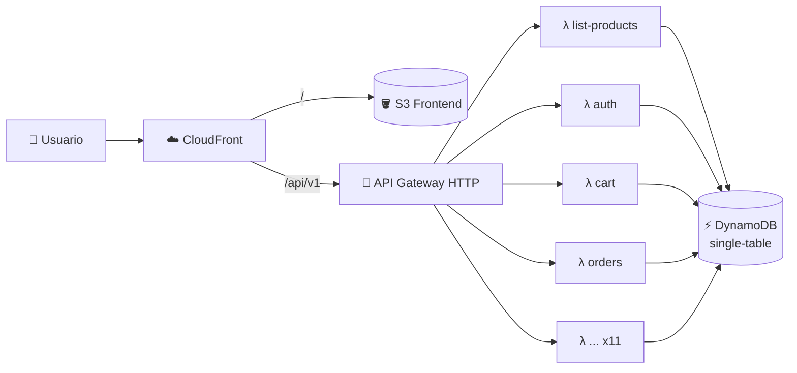

# ⚡ Nexo Store — E-commerce Serverless

**AWS Lambda · API Gateway · DynamoDB single-table · CloudFront**

---

## 🏗️ Arquitectura

## 🧠 Modelo de datos (single-table)

| Entidad                 | PK             | SK                         |
| ----------------------- | -------------- | -------------------------- |
| Producto                | `PRODUCT#<id>` | `META`                     |
| Por categoría (GSI1)    | `CAT#<id>`     | `PRODUCT#<name>`           |
| Catálogo popular (GSI2) | `CATALOG`      | `<ventas invertidas>#<id>` |
| Sesiones / rate limit   | con **TTL**    | autolimpieza               |

> ✍️ Órdenes y signup con `TransactWriteItems`. Carrito con versión optimista.

## 🔥 La saga del N+1

|                     | Antes     | Después   |
| ------------------- | --------- | --------- |
| `list-products` p50 | 473 ms    | **21 ms** |
| Peor caso           | 13.5 s 💀 | **1.4 s** |
| Sockets saturados   | sí        | **0**     |

~250 queries en paralelo por categoría ➜ **una Query paginada sobre GSI2**.

## 🚀 Pipeline

`PR` ➜ lint · build · tests Dynamo · Playwright E2E ➜ `main` ➜ changeset seguro ➜ deploy ➜ smoke test en vivo

---

Hecho a las 3 AM con ☕ y cero vergüenza · Lean_Dev

