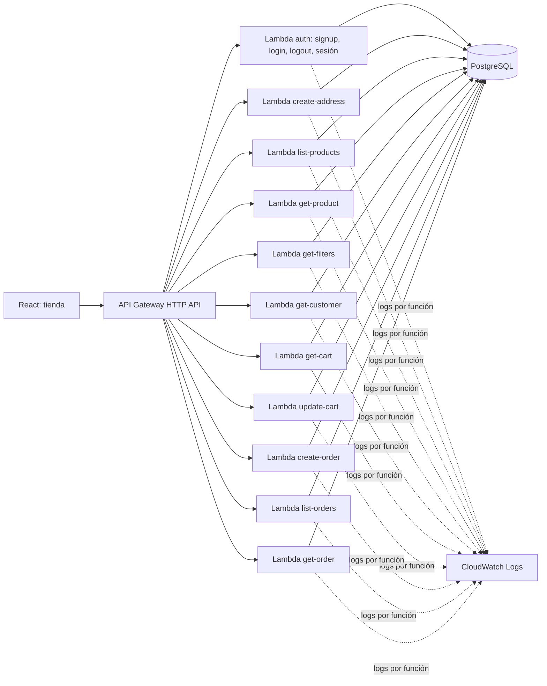

# Nexo Store: una API con once Lambdas

Registro, login con email y contraseña, productos, carrito persistente y pedidos con confirmación. Esta carpeta es una copia de aprendizaje: el proyecto original en `~/ecommerce-lab` no se modificó. La implementación anterior está en `backups/`.

## Ver la tienda local

```bash
npm ci
npm run demo
```

Abrí http://127.0.0.1:3000 y elegí **Crear cuenta**. El registro te deja conectado; después podés cerrar sesión e ingresar con ese email y contraseña. Docker crea una base **local desechable** con 15 productos; los pedidos de prueba no cobran dinero. Ctrl+C termina la demo y elimina esa base. Si necesitás otro puerto: `PORT=3010 npm run demo`.

La demo ejecuta los once handlers con eventos HTTP v2. `api/src/local-api.ts` hace de API Gateway únicamente en tu PC. **No se sube como Lambda.** El frontend es React, separado del backend.

## Qué archivo atiende cada operación

| Petición                                | Lambda / archivo en `api/src/functions/`                         |
| --------------------------------------- | ---------------------------------------------------------------- |
| `POST /api/v1/auth/signup`              | `auth.ts`: crear usuario, credenciales y sesión                  |
| `POST /api/v1/auth/login`               | `auth.ts`: verificar contraseña e iniciar sesión                 |
| `POST /api/v1/auth/logout`              | `auth.ts`: revocar sesión y borrar cookie                        |
| `GET /api/v1/auth/session`              | `auth.ts`: recuperar el usuario conectado                        |
| `POST /api/v1/store/customer/addresses` | `create-address.ts`: guardar dirección propia                    |
| `GET /api/v1/store/products`            | `list-products.ts`: listado y búsqueda                           |
| `GET /api/v1/store/products/{id}`       | `get-product.ts`: ficha, variantes y disponibilidad              |
| `GET /api/v1/store/filters`             | `get-filters.ts`: categorías y marcas                            |
| `GET /api/v1/store/customer`            | `get-customer.ts`: comprador conectado y direcciones             |
| `GET /api/v1/cart`                      | `get-cart.ts`: recuperar carrito                                 |
| `PUT /api/v1/cart`                      | `update-cart.ts`: agregar, cambiar cantidades o quitar artículos |
| `POST /api/v1/orders`                   | `create-order.ts`: confirmar compra y reservar stock             |
| `GET /api/v1/orders`                    | `list-orders.ts`: mis pedidos, paginados                         |
| `GET /api/v1/orders/{id}`               | `get-order.ts`: confirmación y detalle persistido                |

Cada archivo exporta `handler`. Cada función se empaqueta por separado, con su propio rol de ejecución, entorno y grupo de CloudWatch. `shared/` contiene código reutilizable, no otra Lambda.



Es una API distribuida entre funciones con **una base compartida**. Las funciones comparten PostgreSQL; no tienen bases independientes. Los paquetes de Lambda no contienen React, Fastify ni los otros handlers. Hay once funciones y catorce rutas: las cuatro rutas de autenticación pertenecen a una misma Lambda.

## Seguí una compra en el código

1. `get-product` devuelve variantes y precios. La UI elige la variante y cantidad.
2. `update-cart` guarda IDs y cantidades; los precios se leen de PostgreSQL. Una versión evita sobrescribir cambios de otra pestaña.
3. La UI llama `create-order` con dirección, versión del carrito y `Idempotency-Key` UUID v4.
4. Una transacción bloquea ese carrito, valida la dirección y bloquea el inventario en orden estable. Calcula el total con `BigInt`, reserva stock y guarda pedido, artículos e historial.
5. En la misma transacción vacía el carrito y asocia la clave al pedido. Ante un error revierte todo; repetir la misma clave recupera el pedido ya creado.
6. React muestra número, artículos y total. “Mis pedidos” usa `list-orders` y `get-order` para consultar lo que quedó guardado, incluso después de recargar.

La confirmación es **pedido creado y stock reservado**. No significa pago aprobado; no hay pasarela, cobros ni correos automáticos. No hace falta una Lambda que llame a otras tres para conseguir esta transacción.

## Login propio contra PostgreSQL

`api/src/functions/auth.ts` maneja registro, login, logout y consulta de sesión. El usuario ingresa **email y contraseña**. No hay Cognito ni cuentas IAM de compradores.

1. Signup valida nombre, email y contraseña de 12–128 caracteres. Crea un usuario nuevo y su cuenta en una transacción. Un email ya existente no se vincula automáticamente a datos ajenos.
2. `shared/passwords.ts` deriva un hash **scrypt** con salt aleatorio por contraseña (`N=131072, r=8, p=1`). Solo `auth` carga ese código; tiene 512 MiB de memoria. La contraseña nunca se guarda ni se registra en logs.
3. Login verifica la contraseña y genera un token aleatorio de 32 bytes. La base guarda solo el SHA-256 de ese token, asociado al usuario y con vencimiento a las ocho horas.
4. La respuesta establece una cookie `HttpOnly; SameSite=Strict; Path=/`. En HTTPS se llama `__Host-nexo_session` y lleva `Secure`. La excepción HTTP requiere `LOCAL_DEVELOPMENT=true`, un origen loopback y no estar ejecutándose en Lambda.
5. **Cada Lambda de la tienda valida la sesión antes de ejecutar su operación**, mediante `shared/http.ts`. El `customerId` sale de PostgreSQL; no del body, un encabezado del cliente ni una variable de comprador de demo.
6. Logout elimina la sesión de la base y limpia la cookie. Las siguientes solicitudes quedan rechazadas de inmediato. Una sesión vencida devuelve 401 y React vuelve a mostrar el login.

El navegador conserva la cookie automáticamente; no guardamos tokens en `localStorage`. Los POST/PUT exigen que `Origin` coincida exactamente con `APP_ORIGIN` para prevenir solicitudes desde otros sitios. El login tiene límites persistentes de intentos por email e IP (ventanas de quince minutos), compartidos por todas las instancias Lambda.

La cuenta nueva empieza con su carrito vacío y sin pedidos ajenos. Podés agregar una dirección desde el checkout y completar la compra.

## Qué hace IAM ahora

La autenticación de compradores ocurre dentro de las Lambdas con la sesión de PostgreSQL. La plantilla **ya no exige `AWS_IAM` en API Gateway**, porque el navegador se autentica con esa cookie. Las rutas de autenticación no requieren una sesión previa; las de tienda sí la verifican en su handler.

Cada función conserva su **rol IAM de ejecución**, con permiso de escritura en su propio grupo de CloudWatch y lectura del secreto de conexión específico en Secrets Manager. API Gateway tiene permisos de invocación generados por SAM. Los permisos SQL se controlan en PostgreSQL; un rol IAM no concede acceso automáticamente a la base externa.

Frontend y `/api/*` se publican bajo el **mismo origen HTTPS** con CloudFront. El frontend vive en un bucket S3 privado; `/api/*` se reenvía a API Gateway con las cookies y sin caché. `AppOrigin` define ese origen exacto sin barra final.

Este alcance incluye registro, login y logout. Recuperación de contraseña, verificación de email y MFA quedan pendientes; no se envían correos. La limpieza periódica de sesiones vencidas y contadores viejos debe programarse antes de operar a largo plazo:

```sql
DELETE FROM store_sessions WHERE expires_at < now();
DELETE FROM store_auth_limits WHERE window_start < now() - interval '1 day';
```

Referencias: [scrypt en Node.js](https://nodejs.org/docs/latest-v24.x/api/crypto.html#cryptoscryptpassword-salt-keylen-options-callback), [almacenamiento de contraseñas](https://cheatsheetseries.owasp.org/cheatsheets/Password_Storage_Cheat_Sheet.html), [sesiones](https://cheatsheetseries.owasp.org/cheatsheets/Session_Management_Cheat_Sheet.html).

## Logs: dónde mirar cuando algo falla

`shared/http.ts` agrega a cada invocación:

- `function`, `requestId` de Lambda y `gatewayRequestId` de API Gateway.
- `request.start` con `coldStart`; `request.complete` con estado y duración.
- `request.error` con tipo/código técnico, sin cuerpo, correo, dirección ni contraseña.
- Eventos de negocio: `cart.updated`, `order.created`, `order.replayed`.

La respuesta incluye `x-request-id` y `x-lambda-function`. La terminal de la demo muestra esos mismos logs JSON. En AWS irían a `/aws/lambda/<stack>-<nombre-funcion>`, con retención de siete días. Los rechazos de sesión se registran como `request.error` con estado 401. `auth.signup`, `auth.login` y `auth.logout` permiten seguir el flujo sin registrar contraseñas, emails ni cookies.

Ejemplo de consulta en CloudWatch Logs Insights, después de desplegar:

```text
fields jsonParse(message) as app
| fields @timestamp, app.function, app.event, requestId, app.gatewayRequestId, app.statusCode, app.durationMs, app.orderId
| filter requestId = "ID-DEVUELTO-EN-X-REQUEST-ID"
| sort @timestamp asc
```

El pool se crea una vez por entorno caliente y admite dos conexiones. Si hay muchas instancias Lambda, esas conexiones se multiplican: una base de 1 GB exige límites de concurrencia y una estrategia de conexiones antes de escalar. Los timeouts de consulta son 15 s; Lambda tiene 28 s y la integración HTTP 29 s. Varias consultas lentas pueden agotar el presupuesto total; la clave de reintento permite recuperar una confirmación cuya respuesta se perdió.

## Probar y empaquetar

El código usa ESLint para TypeScript y Prettier para formato. VS Code tiene configurados
formato al guardar y correcciones de ESLint, con las extensiones recomendadas en `.vscode/`.
Las reglas mantienen una declaración por sentencia y llaves explícitas en los bloques.

```bash
npm run format           # Formatear el código
npm run lint:fix         # Corregir automáticamente lo que ESLint pueda resolver
npm run check            # Lint, formato y TypeScript del backend y frontend
```

Se fijó TypeScript 6.0.3 porque la versión instalada de `typescript-eslint` admite
TypeScript >=4.8.4 y <6.1.0. No se fuerzan dependencias incompatibles. La configuración
sigue las guías de [typescript-eslint](https://typescript-eslint.io/getting-started/)
y [Prettier](https://prettier.io/docs/install).

```bash
npm test                 # DB Docker desechable; checkout, rollback, reintentos, concurrencia y logs
npm run build            # TypeScript del backend
npm run build:ui         # TypeScript + build de React
npm run package:lambda   # once ZIP y plantilla SAM; no despliega
```

Con la demo en otro terminal, el recorrido de navegador se verifica con:

```bash
TEST_URL=http://127.0.0.1:3000 node scripts/check-storefront.mjs
```

Ese recorrido crea una cuenta nueva, prueba login/logout, agrega una dirección y crea un pedido de prueba. Usa Google Chrome instalado localmente.

Los ZIP quedan en `dist/functions/<nombre>.zip`. En cada ZIP el handler AWS es `index.handler`, con Node.js 24. `scripts/package-lambda.mjs` comprueba que cada bundle incluya solo su handler y las librerías que necesita. La plantilla se genera desde `api/src/routes.ts`; API Gateway hace el enrutamiento en AWS.

## Desplegar en AWS

La región del proyecto es **Ohio (`us-east-2`)**, el perfil CLI es `nexo-lab` y el stack es `nexo-lab`. AWS SAM está instalado en `~/.local/bin/sam`.

```bash
aws login --profile nexo-lab --region us-east-2  # Cuando venza la sesión
npm run deploy:lambda
```

El comando compila y empaqueta las once funciones, valida la plantilla SAM y despliega con CloudFormation. Publica React en S3 y CloudFront. En la primera ejecución crea la distribución y después configura su dominio como `APP_ORIGIN`. En las siguientes actualiza el mismo stack. Los identificadores públicos están en `deploy/lambda/config.json`; la URL resultante queda en `deploy/lambda/outputs.json`.

La base existente permanece en Singapur y escucha únicamente en localhost del VPS. `shared/database.ts` abre un puente SSH desde cada entorno Lambda, sin depender de la computadora. La clave permite exclusivamente conexiones a PostgreSQL y no acceso a una consola del VPS; se verifica la huella del servidor. Es una adaptación para este laboratorio externo. Una arquitectura AWS con base dentro de una VPC usaría conexión privada y, según la carga, un pooler o RDS Proxy.

El secreto `nexo-lab/database` guarda la conexión del rol PostgreSQL `nexo_lambda`, la clave SSH dedicada y la huella verificada. No está incluido en los ZIP ni en la configuración pública. El rol de base no es administrador y tiene límite de 30 conexiones. Los cambios se prepararon explícitamente con `scripts/configure-lab-database.mjs`; las migraciones 006/007 agregan tablas de carrito, idempotencia, cuentas, sesiones y límites de intentos sobre la base remota. Los handlers nunca migran al arrancar.

Para ver llamadas reales:

```bash
aws logs tail /aws/lambda/nexo-lab-auth --follow --profile nexo-lab --region us-east-2
aws logs tail /aws/lambda/nexo-lab-create-order --follow --profile nexo-lab --region us-east-2
```

Los recursos generan consumo de AWS. La plantilla crea once Lambdas, API Gateway, logs con retención de siete días, roles, un bucket privado y CloudFront; no crea EC2 ni una base RDS.

Referencias oficiales: [API Gateway HTTP en SAM](https://docs.aws.amazon.com/serverless-application-model/latest/developerguide/sam-property-function-httpapi.html), [logs Node.js en Lambda](https://docs.aws.amazon.com/lambda/latest/dg/nodejs-logging.html).
